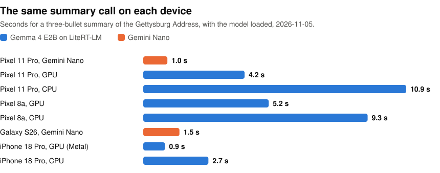

# litert-lm-kmp

Run LLMs on the phone from Kotlin Multiplatform: one API in `commonMain` for Android, iOS and the JVM, on Google's [LiteRT-LM](https://github.com/google-ai-edge/LiteRT-LM) 0.19.1. Measured on LiteRT-LM 0.19.0 with Gemma 4 E2B loaded on the GPU: an iPhone 18 Pro summarized the Gettysburg Address in 0.9 s and a Pixel 8a in 5.2 s. Android phones with Gemini Nano can run the same call on Nano. A Galaxy S26 took 1.5 s.

<p align="center">
<picture>
  <source media="(prefers-color-scheme: dark)" srcset="https://raw.githubusercontent.com/john-rocky/litert-lm-kmp/main/docs/images/summary-time-dark.svg">
  
</picture>
</p>

```kotlin
// In commonMain.dependencies, in shared/build.gradle.kts
implementation("io.github.john-rocky.litertlm:litertlm-genai:0.1.1")
```
```kotlin
import io.github.johnrocky.litertlm.genai.summarization.*

// At most three bullets. An article has to be at least 400 characters.
suspend fun summarize(article: String): String {
    val options = SummarizerOptions.builder()
        .setOutputType(SummarizerOptions.OutputType.THREE_BULLETS)
        .build()
    return Summarization.getClient(options).use {
        it.runInference(SummarizationRequest.builder(article).build()).summary
    }
}
```

In a project from the [KMP wizard](https://kmp.jetbrains.com), that is all the setup on Android and the JVM. You don't pass an API key or a `Context`. iOS adds one Swift package ([iOS](#ios)). The first request downloads Gemma 4 E2B (2.6 GB, Apache-2.0). Keep the screen on until it finishes: on a Pixel 8a the download failed 14 s after the screen went off.

By default the model runs on the CPU, where the same summary took 2.7 s on the iPhone and 9.3 s on the Pixel 8a. To put it on the GPU, pass [`Backend.GPU()`](docs/who-answers.md). In an app, keep one client open while the screen that uses it is open, because a new client for each request loads the model again.

The task APIs use the same class, method and constant names as ML Kit GenAI. To port ML Kit code, change the import and call the `suspend` functions instead of waiting on futures. You can also use your own `.litertlm` file, from a public Hugging Face repository or from disk.

This is an independent project, not a Google product.

## Install

| You need | Because |
|---|---|
| `google()` and `mavenCentral()` in the repositories | LiteRT-LM is on Google Maven. A project from the KMP wizard has both. |
| Kotlin 2.3.0 or newer | On iOS an older compiler cannot read these klibs. On Android it cannot read the Kotlin standard library that Google's runtime brings. Checked with 2.3.0, 2.3.10 and 2.4.21. |
| `minSdk` 24 on Android | The wizard's default. [Gemini Nano](#gemini-nano) and JetBrains' [Koog](docs/lower-level.md#koog) agents need 26. |
| Java 21 for the JVM target | Google's `litertlm-jvm` is Java 21 bytecode. The wizard's Gradle already runs on 21. Elsewhere, add `kotlin { jvmToolchain(21) }`. |

### iOS

The Kotlin code comes from Maven. Google's native runtime, `CLiteRTLM.xcframework`, comes from a Swift package. In Xcode, choose **File > Add Package Dependencies...**, enter `https://github.com/john-rocky/litert-lm-kmp` and add the product `CLiteRTLM` to the app target.

The package declares iOS 15, and I ran it on iOS 27.2. The simulator runs the CPU backend only. Gemma 4 E2B needs no extra entitlements on an iPhone 18 Pro. For a larger model, add the two memory entitlements on [the install page](docs/install.md#ios).

### Gemini Nano

On Android phones that have Gemini Nano, the library can answer with it instead of a downloaded model. Add one more dependency to the same file:

```kotlin
androidMain.dependencies {
    implementation("io.github.john-rocky.litertlm:litertlm-genai-nano:0.1.1")
}
```

With it, the same calls try Gemini Nano first and fall back to the local model ([how it chooses](docs/who-answers.md)). This dependency uses ML Kit GenAI, which has its own [terms](https://developers.google.com/ml-kit/genai-terms), and needs `minSdk` 26.

## What you can call

Each task client works the same way: `getClient`, `runInference`, `close`. `Generation` gives you a `GenerativeModel`, which calls `generateContent` instead.

| Task | Client |
|---|---|
| Summarize | `Summarization.getClient(options)` |
| Proofread | `Proofreading.getClient(options)` |
| Rewrite | `Rewriting.getClient(options)` |
| Describe an image | `ImageDescription.getClient(options)` |
| Prompt or chat | `Generation.getClient()` |

Tool calls and embeddings use a lower-level API: `Engine`, `Conversation` and `EmbeddingEngine`, named as in Google's Kotlin API.

## Documentation

- [Install in detail](docs/install.md): app size, iOS and Gemini Nano
- [Tasks and chat](docs/tasks.md): code for each task, called from Android, iOS and the JVM
- [Gemini Nano, the local model and the GPU](docs/who-answers.md): how the library chooses, and how you choose
- [Choose the model](docs/choose-the-model.md): your own file, download progress, GPU and CPU speeds
- [The lower level](docs/lower-level.md): `Engine`, `Conversation`, `EmbeddingEngine` and Koog
- [Compose Multiplatform](docs/compose-multiplatform.md)
- [Failures](docs/failures.md): the exceptions and the common error codes
- [Tested devices](docs/tested-devices.md): what ran on each phone, and how to run the checks yourself

## Not supported

- Audio input.
- The NPU.
- Running in a browser.
- Automatic tool calling: `automaticToolCalling` must stay `false`.
- Apple's Foundation Models API. For that, use [swift-litert-lm](https://github.com/john-rocky/swift-litert-lm) from a Swift app.

## Tested on

I ran the checks in `sample-shared` on each device with LiteRT-LM 0.19.0, on 2026-11-05. None failed. Up to 5 were skipped on a device, for example the download checks on a phone with no network. On 2026-11-11 I ran the LiteRT-LM checks again with 0.19.1 on the Pixel 11 Pro, the iPhone 18 Pro and the Mac, and none failed. Everything else on this page and in `docs/` was measured with 0.19.0.

| Device | OS | Runs |
|---|---|---|
| Galaxy S26 | Android 16 | Gemini Nano, every task |
| Pixel 11 Pro | Android 17 | LiteRT-LM on GPU and CPU, Gemini Nano summarization |
| Pixel 8a | Android 16 | LiteRT-LM on GPU and CPU, the default provider without Nano, an app without the Nano dependency |
| iPhone 18 Pro | iOS 27.2 | LiteRT-LM on Metal and CPU |
| Mac, Apple M4 Max | macOS 27.0, JVM | LiteRT-LM on CPU |

One check is not reliable when repeated. On the Pixel 11 Pro with Gemini Nano, the streamed chunks of a three-bullet summary dropped a word, an apostrophe or a line break in 8 of 75 runs, while the final result had the whole text ([Tasks](docs/tasks.md)).

## Samples

`sample-android` and `sample-ios` share one Compose screen, in `sample-shared`. It has a chat and every task, and you can switch between Gemini Nano and the local model and between the GPU and the CPU. To put it on an Android phone, run `./gradlew :sample-android:installDebug`. For iOS, open `sample-ios/Sample.xcodeproj` and set your team.

## License

Apache-2.0. See [LICENSE](LICENSE) and [NOTICE](NOTICE). Gemma 4 E2B is Apache-2.0 too.
